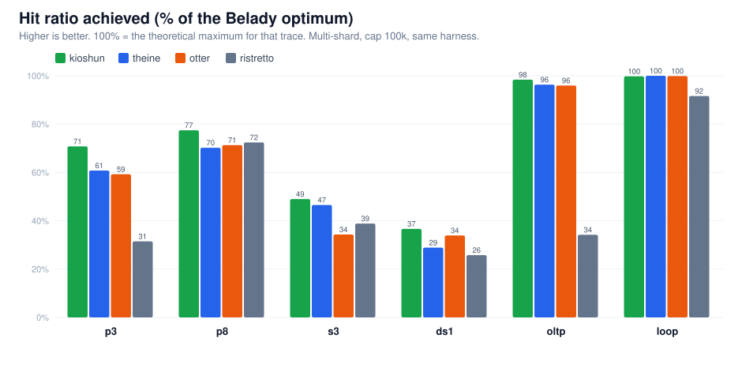
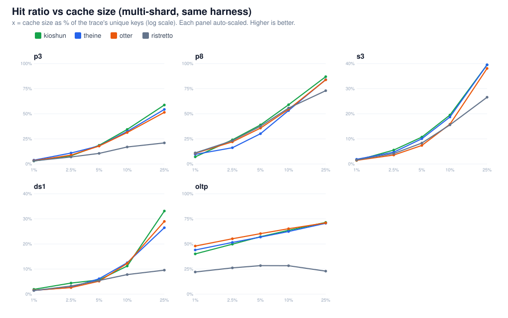
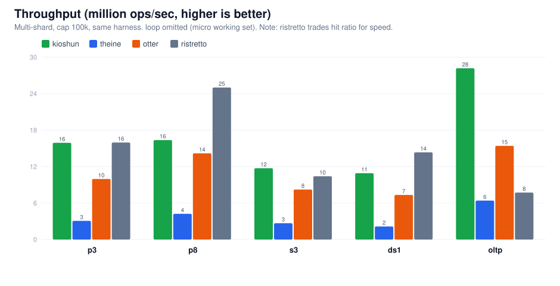
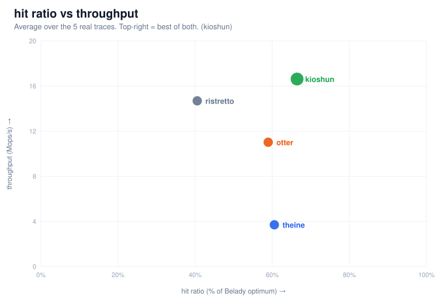

<div align="center">
  

  # Kioshun - In-Memory Cache for Go

  *"kee-oh-shoon" /kiːoʊʃuːn/*

  [](https://golang.org)
  [](LICENSE)
  [](https://github.com/unkn0wn-root/kioshun/actions)


  *Fast, sharded in-memory cache for Go*
</div>

## Index

- [Installation](#installation)
- [Quick Start](#quick-start)
- [Configuration](#configuration) ([full reference](docs/configuration.md))
- [API](#api)
- [HTTP Middleware](#http-middleware) ([full reference](docs/http.md))
- [Internals](docs/internals.md)
- [Benchmarks](#benchmarks)

## Installation

```bash
go get github.com/unkn0wn-root/kioshun
```

## Quick Start

```go
package main

import (
    "fmt"
    "time"

    "github.com/unkn0wn-root/kioshun"
)

func main() {
    c := kioshun.NewDefault[string, string]()
    defer c.Close()

    c.Set("user:123", "David", kioshun.DefaultExpiration)

    // Set returns after the value is readable.
    c.Set("user:456", "John", kioshun.NoExpiration)

    // SetAsync may queue the write.
    c.SetAsync("user:789", "Paul", 5*time.Minute)

    // Sync waits for all accepted writes.
    c.Sync()

    if value, found := c.Get("user:123"); found {
        fmt.Printf("User: %s\n", value)
    }

}
```

## Configuration

For most caches, start with the built-in defaults:

```go
c := kioshun.NewDefault[string, string]()
defer c.Close()
```

`NewDefault` uses `DefaultConfig()`: `MaxSize=10000`, `DefaultTTL=30m`,
automatic shard count, `CleanupInterval=5m`, SieveTinyLFU eviction, stats
disabled and the default async write buffer/batch sizes.

When you only need a few changes, start from `DefaultConfig()` and override the
specific fields:

```go
config := kioshun.DefaultConfig()
config.MaxSize = 100000
config.DefaultTTL = time.Hour

c, err := kioshun.New[string, string](config)
if err != nil {
	panic(err)
}
```

> Every `Config` field, weighted capacity (`MaxCost` + `WithWeigher`) and the
> named cache `Manager` are covered in **[configuration.md](docs/configuration.md)**.

## API

```go
c.Set(key, value, ttl time.Duration) error
c.SetAsync(key, value, ttl time.Duration) error
c.SetWithCallback(key, value, ttl, callback func(key, value)) error
c.Get(key) (value, found bool)
c.GetWithTTL(key) (value, ttl time.Duration, found bool)
c.Keys() []K
c.Clear()
c.Sync() error
c.Delete(key) bool
c.Exists(key) bool
c.Size() int64
c.Stats() Stats
c.PolicyStats() PolicyStats
c.Cleanup()
c.Close() error
```

> `Set` is synchronous and gives immediate 'read-after-write' visibility for the key.
> `SetAsync` is optional. It may have committed inline already or it may still be queued.
> Use `Sync` when committed visibility is required.
> A negative TTL other than `NoExpiration` (-1) means already expired: the call stores nothing and removes the key.

## HTTP Middleware

The middleware is a shared HTTP cache. With the default policy, it stores only responses that carry explicit freshness (`max-age`, `s-maxage` or `Expires`) or are marked `public`.

```go
import "github.com/unkn0wn-root/kioshun/httpcache"

config := httpcache.DefaultConfig()
config.DefaultTTL = 5 * time.Minute // for public responses without max-age or Expires
config.MaxSize = 100000

middleware, err := httpcache.New(config)
if err != nil {
	panic(err)
}
defer middleware.Close()

usersHandler := http.HandlerFunc(func(w http.ResponseWriter, r *http.Request) {
	w.Header().Set("Cache-Control", "public, max-age=60")
	w.Write([]byte(`["alice","bob"]`))
})
http.Handle("/api/users", middleware.Wrap(usersHandler))
```
> See **[http.md](docs/http.md)** for complete documentation.

## Benchmarks

### Hit ratio and throughput

Kioshun is compared against [Ristretto](https://github.com/dgraph-io/ristretto), [Otter](https://github.com/maypok86/otter) and [Theine](https://github.com/Yiling-J/theine-go)
by replaying ARC and LIRS request traces (P3, P8, S3, DS1, OLTP, LOOP) through every cache in the **same harness**.









Results at the 100,000 entry limit, with Ristretto v2.4.2, Otter v2.4.0 and Theine v0.6.3:

| trace | OPT | kioshun | theine | otter | ristretto |
|---|---|---|---|---|---|
| p3 | 62.00% | **43.88%** | 37.68% | 36.73% | 19.52% |
| p8 | 77.12% | **59.73%** | 54.15% | 54.98% | 55.84% |
| s3 | 25.42% | **12.45%** | 11.83% | 8.72% | 9.88% |
| ds1 | 5.16% | **1.89%** | 1.49% | 1.75% | 1.33% |
| oltp | 79.56% | **78.28%** | 76.65% | 76.37% | 27.21% |
| loop | 99.80% | 99.56% | **99.79%** | 99.70% | 91.45% |

Hit ratio as a percent of that ceiling:

| trace | kioshun | theine | otter | ristretto |
|---|---|---|---|---|
| p3 | **70.8** | 60.8 | 59.2 | 31.5 |
| p8 | **77.5** | 70.2 | 71.3 | 72.4 |
| s3 | **49.0** | 46.5 | 34.3 | 38.9 |
| ds1 | **36.6** | 28.9 | 33.9 | 25.8 |
| oltp | **98.4** | 96.3 | 96.0 | 34.2 |
| loop | 99.8 | **100.0** | 99.9 | 91.6 |
| geomean | **67.7** | 61.7 | 60.1 | 43.9 |

### Microbenchmarks

A separate suite compares Kioshun with Ristretto, BigCache, FreeCache and go-cache using pre-generated workloads with async and strict write modes reported separately:

```bash
cd benchmarks
go test -run=TestBenchmarkComparisonGetSetup -count=1 .
go test -bench='BenchmarkCacheComparison' -benchmem -run=^$ -benchtime=1s .
go test -bench=. -benchmem -run=^$ -benchtime=1s -timeout=30m .
```
